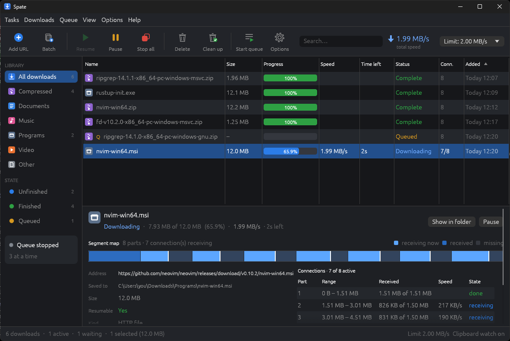
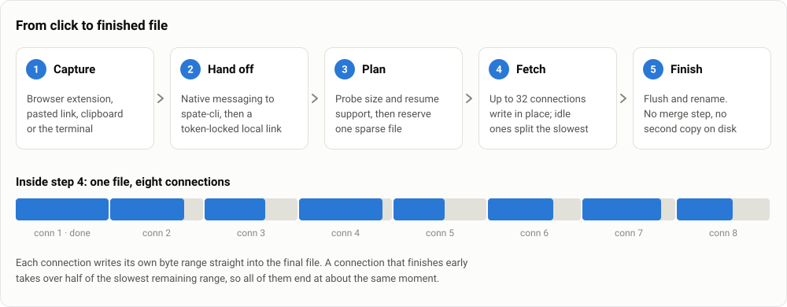
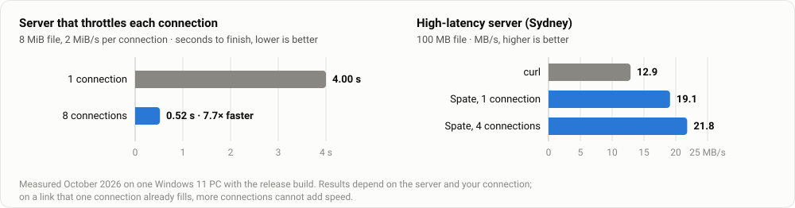

<div align="center">


# Spate

**A fast, free and open-source download manager for Windows.**

Every connection writes straight into the finished file, so there is nothing to merge when the download ends.

<p>
  <a href="https://github.com/VinZie/spate/actions/workflows/ci.yml"></a>
  <a href="https://github.com/VinZie/spate/releases/latest"></a>
  <a href="https://github.com/VinZie/spate/releases"></a>
  <a href="LICENSE"></a>
  
  
</p>

<p>
  <a href="https://github.com/VinZie/spate/releases/latest"><b>Download</b></a> ·
  <a href="#quick-start">Quick start</a> ·
  <a href="#how-it-works">How it works</a> ·
  <a href="#performance">Performance</a> ·
  <a href="#faq">FAQ</a> ·
  <a href="CONTRIBUTING.md">Contributing</a>
</p>



</div>

> [!NOTE]
> Spate 0.1 is an early release for Windows 10 and 11 (64-bit). The executables are not code-signed yet, and the browser extension is loaded unpacked until it is published in the browser stores.

Spate splits each download across several connections, keeps every connection busy until the very end, resumes interrupted transfers and catches downloads from your browser. It is two small executables with no installer, no administrator rights, no drivers, no ads and no telemetry.

## Why Spate

- **No merge step.** Many download managers save each connection to its own temporary file and stitch the pieces together when the download ends, which rewrites most of the file a second time. Spate's connections write into one preallocated file at their own offsets, so the download is finished the moment the last byte arrives.
- **Connections finish together.** When a connection runs out of work it takes over half of the slowest remaining range, split by speed, so no single slow connection holds up the end of the download.
- **Polite to strict servers.** If a server refuses extra connections (HTTP 429 or 503), Spate drops to the number it allows, honours `Retry-After`, tries more again later and remembers the limit for that server.
- **A browser bridge web pages can't reach.** The extension talks to Spate through the browser's native messaging, and the helper talks to the app over a local link that needs a secret token. There is no local web server for a page to find.
- **Safe resumes.** Every partial response is checked (offset, size, ETag), and overlapping bytes between neighbouring connections are compared, so a file that changed on the server restarts cleanly instead of being stitched from two versions.
- **Scriptable.** `spate-cli` downloads in the terminal, hands links to the app and accepts Windows-style `/d /p /f /n /a` switches for batch files.

## Quick start

### Install

1. Download `Spate-<version>-windows-x64.zip` from the [latest release](https://github.com/VinZie/spate/releases/latest).
2. Unzip it somewhere it can stay, for example `%LOCALAPPDATA%\Programs\Spate`.
3. Run `spate.exe`. If SmartScreen says "Windows protected your PC", choose **More info → Run anyway**.

### Add downloads

- Click **Add URL** (Ctrl+N). Spate checks the file's name, size and resume support before you start.
- Use **Batch** to paste many links, or a pattern such as `https://example.com/photo-*.jpg` with a range like 001 to 120 (letter ranges work too).
- Turn on **Options → Watch clipboard for links** to have Spate offer every link you copy.

### Catch downloads from your browser

1. In Spate, open **Options → Browser integration…** and click **Register helper**. This writes per-user registry entries only; `spate-cli uninstall-host` removes them.
2. Load the extension that ships in the zip:
   - **Chrome, Edge, Brave:** open `chrome://extensions` (`edge://extensions` in Edge), turn on **Developer mode**, click **Load unpacked** and pick `extension\chromium`.
   - **Firefox:** open `about:debugging#/runtime/this-firefox`, click **Load Temporary Add-on…** and pick `extension\firefox\manifest.json`. Firefox removes temporary add-ons when it restarts.

### Use the terminal

```powershell
spate-cli get https://example.com/big.iso -c 16 --limit 20M   # Ctrl+C pauses; run again to resume
spate-cli info https://example.com/big.iso                    # name, size, resume support
spate-cli bench https://example.com/big.iso --connections 1,4,8,16
spate-cli add https://example.com/file.zip                    # hand to the app (starts it if needed)
spate-cli /d https://example.com/file.zip /n /a               # Windows-style switches
```

Run `spate-cli --help` for everything else.

### Build from source

You need a recent stable Rust toolchain (developed with 1.96) and Node.js 22 or newer for the extension.

```powershell
git clone https://github.com/VinZie/spate.git
cd spate
cargo build --release                      # target\release\spate.exe and spate-cli.exe
cargo test --workspace
cd extension; npm test; npm run build      # extension\dist\chromium and dist\firefox
cd ..; pwsh packaging\package-windows.ps1  # dist\Spate-<version>-windows-x64.zip
```

## How it works

<p align="center">
  
</p>

- **Capture.** The extension, the clipboard watcher, the Add URL dialog or `spate-cli` hands Spate a link, along with the cookies, referrer and user agent the browser would have sent.
- **Hand off.** Browsers start `spate-cli` as a native-messaging host and only let Spate's own extension ID talk to it. The host passes the link to the app over a loopback connection that needs the random token in `%LOCALAPPDATA%\Spate\ipc.json`, a file web pages cannot read.
- **Plan.** Spate asks the server for the size and whether it accepts byte ranges, then reserves the whole file as a sparse file, so Windows does not zero-fill gaps when a connection starts deep inside a large file.
- **Fetch.** Up to 32 connections (8 by default) each fetch one range and write it at its own offset. Progress is saved every few seconds, so a crash or reboot resumes where it stopped.
- **Finish.** The file is flushed to disk and renamed from `name.part` to its real name. There is no assembly step.

## Performance

<p align="center">
  
</p>

| Test | Result |
|---|---|
| Server that limits each connection to 2 MiB/s, 8 MiB file | 1 connection 4.00 s · 8 connections **0.52 s (7.7× faster)** |
| High-latency server in Sydney, 100 MB | curl 12.9 MB/s · Spate **19.1 MB/s** with 1 connection, **21.8 MB/s** with 4 |
| Nearby server on a 750 Mbit/s link, 100 MB | about 1.1 s, the same as curl: the link is the limit |
| Local loopback, 512 MiB, 8 connections | about 1.1 GB/s end to end, limited by the disk |

Measured in October 2026 on one Windows 11 PC with the release build. More connections help when the server or the path limits each connection; on a link that a single connection already fills, Spate matches a single connection instead of slowing down. Measure your own with `spate-cli bench <url>`.

## Features

| Area | What you get |
|---|---|
| **Engine** | HTTP and HTTPS (rustls, HTTP/2) · 1–32 connections · pause and resume with crash-safe checkpoints · automatic restart when the remote file changes · retries with backoff and stall detection · adaptive connection limits · global and per-download speed limits · SHA-256 verification · file names from `Content-Disposition` (RFC 6266 and 5987), made safe for Windows |
| **Streaming video** | HLS (`.m3u8`): picks a variant from the master playlist, AES-128 decryption, fMP4 with `EXT-X-MAP`, byte-range segments, segments fetched in parallel |
| **Organising** | Persistent download list · a queue that runs *N at a time* · daily start and stop times · automatic retries for queued items · categories with their own folders (Compressed, Documents, Music, Programs, Video, General) |
| **Desktop app** | Sortable download table with category and state filters · live segment map with per-connection speeds · Add URL, Batch and browser-capture dialogs · clipboard watcher · tray icon · in-app notices · start at sign-in · light and dark themes |
| **Command line** | `get` with resume · `info` · `bench` · `add` / `show` · `status` · Windows-style switches · the browser's native-messaging host with `install-host` / `uninstall-host` |
| **Browser extension** | Chrome, Edge, Brave and Firefox (Manifest V3) · download capture that falls back to the browser if Spate isn't running · context menus for a link, media, all links or selected links · media and HLS detection with a popup list · file-type, minimum-size and excluded-site options |

## Security and privacy

- **No local web server.** Spate never listens for WebSocket or HTTP requests from web pages and sends no CORS headers, so a website cannot start or read downloads.
- **Locks on the browser bridge.** Browsers only let the extension IDs registered in the host manifest start `spate-cli`, and the host checks the caller's origin again. The app accepts commands only with the token from `ipc.json`, and proves it knows that token before a helper sends it anything, so a program squatting on a stale port learns nothing.
- **Credentials stay with their site.** Cookies, `Authorization` and other login headers go only to the exact scheme, host and port they were collected for. Spate follows redirects itself and checks every hop, so they never reach a redirect target, a CDN segment or plain http. The extension hands over only the cookies the browser itself would send (SameSite rules included) and trims the Referer the way browsers do.
- **Nothing secret on disk.** Login headers live in memory for the current session only and are never written to the download list.
- **Downloads are marked as from the internet.** Every finished file carries the Mark of the Web, so SmartScreen, Office Protected View and the macro block treat it like a browser download.
- **No surprise clicks.** A captured download never steals focus: the taskbar button flashes instead. Its Start button waits about a second, held keys are ignored, and Enter only opens a download you picked yourself. The name you confirm is the name that's saved.
- **Careful with files.** File names are cleaned of reserved device names, bidirectional-text tricks and invisible characters. A partial file carries a random token, so Spate never resumes into or deletes a file it didn't create, and a file that fails its checksum never gets its final name.
- **Least privilege.** Everything runs as your user. Browser registration writes only under `HKCU`, and the extension asks for the minimum permissions, each explained in [`extension/README.md`](extension/README.md).
- **No telemetry.** Spate only connects to the servers you download from.

Found a vulnerability? Please report it privately as described in [`SECURITY.md`](SECURITY.md).

## Roadmap

Not supported yet, roughly in order of priority:

- DASH (`.mpd`) streams, separate HLS audio tracks and TS → MP4 remuxing
- An in-page "download this video" button
- FTP and downloads that need a POST request
- Multiple named queues, download quotas and day-of-week schedules
- Per-server connection caps you set by hand, and proxy bypass lists
- Translations
- Signed releases and store-listed browser extensions

Ideas and pull requests are welcome; see [Contributing](#contributing).

## FAQ

<details>
<summary><b>Is Spate really free?</b></summary>

Yes. It is open source under the MIT license, with no ads, trial period, account or telemetry.
</details>

<details>
<summary><b>Why isn't my download faster with more connections?</b></summary>

Extra connections help only when the server or the route limits each connection. If one connection already fills your internet link, more connections can't add speed. Some servers also cap connections per client; Spate detects that (HTTP 429 or 503) and settles on the number the server allows.
</details>

<details>
<summary><b>Windows says "Windows protected your PC". Is that safe?</b></summary>

The executables aren't code-signed yet, so SmartScreen doesn't recognise them. Choose **More info → Run anyway**, or build Spate from source yourself. The release workflow builds every zip on GitHub from the tagged source.
</details>

<details>
<summary><b>Why do I have to load the extension unpacked?</b></summary>

The extension isn't published in the Chrome Web Store or on Firefox Add-ons yet. Loading it unpacked from the zip gives it the same fixed ID that the helper trusts.
</details>

<details>
<summary><b>Can Spate download videos?</b></summary>

It downloads HLS streams (`.m3u8`), which the extension detects on the page. DASH streams and an in-page download button are on the roadmap.
</details>

<details>
<summary><b>Why is the Start button greyed out for a moment?</b></summary>

When a download arrives from your browser or the clipboard, its dialog ignores clicks and Enter for about a second, so a web page can't get a file confirmed while you happen to be typing.
</details>

<details>
<summary><b>A download that needed me to be logged in fails after restarting Spate. Why?</b></summary>

Spate keeps login cookies in memory only and never writes them to disk. After a restart, start the download again from your browser so the extension can hand over fresh cookies.
</details>

<details>
<summary><b>Where does Spate keep its data, and how do I uninstall it?</b></summary>

The download list and settings live in `%LOCALAPPDATA%\Spate` (set `SPATE_DATA_DIR` to move them). To uninstall, run `spate-cli uninstall-host` if you registered the browser helper, turn off start at sign-in in Options, then delete the program folder and `%LOCALAPPDATA%\Spate`.
</details>

<details>
<summary><b>Does it run on Linux or macOS?</b></summary>

Not yet. The engine and command line are written to be portable, but only Windows is built and tested today.
</details>

## Documentation

- [`extension/README.md`](extension/README.md): how the browser extension works and why it needs each permission
- [`packaging/QUICKSTART.txt`](packaging/QUICKSTART.txt): the guide that ships inside the zip
- [`CONTRIBUTING.md`](CONTRIBUTING.md): building, testing and the project layout
- [`SECURITY.md`](SECURITY.md): reporting vulnerabilities
- [`CHANGELOG.md`](CHANGELOG.md): what changed in each release

## Star history

<a href="https://star-history.com/#VinZie/spate&Date">
  <picture>
    <source media="(prefers-color-scheme: dark)" srcset="https://api.star-history.com/svg?repos=VinZie/spate&type=Date&theme=dark">
    
  </picture>
</a>

## Contributing

Bug reports, ideas and pull requests are welcome. Start with [`CONTRIBUTING.md`](CONTRIBUTING.md) for how to build, test and structure a change, and open an issue first for anything large.

## Disclaimer

Spate is provided as is, without warranty. Download only content you have the right to download, and respect the terms of the sites you use.

## License

Spate is released under the [MIT License](LICENSE). The libraries it is built on keep their own licenses; the release zip lists them in `THIRD-PARTY-LICENSES.txt`.
